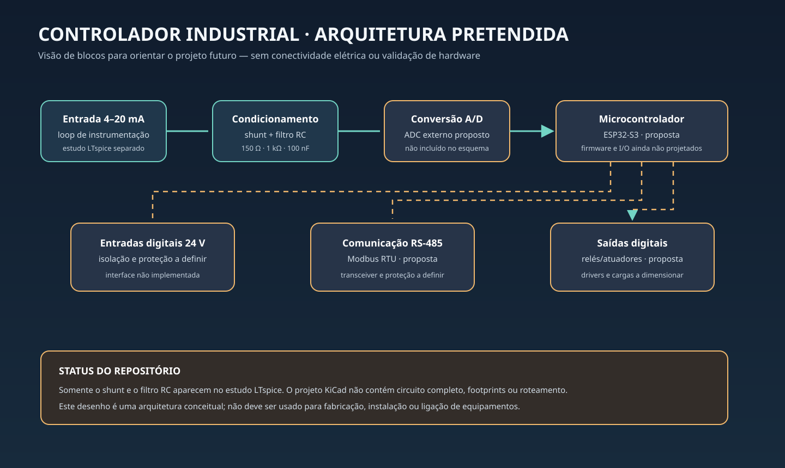

# Estudo de entrada analógica 4–20 mA e controlador industrial

Este repositório reúne um **estudo conceitual** de uma entrada analógica de loop
4–20 mA e um esqueleto inicial de projeto para uma futura placa de I/O industrial.
Os arquivos atuais não compõem uma placa funcional nem um pacote de fabricação.

## O que existe

- `ltspice_sim/Industrial_4_20mA_Analog_Frontend.asc`: estudo isolado com resistor
  shunt de 150 Ω e filtro RC de 1 kΩ/100 nF. A simulação não valida ADC, proteção,
  tolerâncias, isolamento ou comportamento de uma placa completa.
- `kicad_project/`: arquivos KiCad com título e contorno de placa, mantidos apenas
  como **esqueleto não conectado**. O esquema não contém símbolos ou nets e a PCB
  não tem footprints, trilhas conectadas ou zonas de cobre.

## O que ainda precisa ser projetado

Esquema elétrico completo, seleção e dimensionamento dos componentes, isolamento e
proteções, footprints e posicionamento, roteamento, plano de retorno, regras de
fabricação, ERC/DRC aprovados, revisão independente e validação em protótipo.
Compatibilidade eletromagnética, segurança e desempenho industrial não foram
avaliados.

Não há Gerbers, arquivos de furação, BOM de montagem ou arquivo pick-and-place
válidos neste repositório. A pasta `production/` explica os critérios para uma
futura entrega. Nenhum arquivo deve ser enviado a uma fabricante ou usado para
montagem.

O diagrama SVG mostra somente blocos funcionais pretendidos; não representa
ligações, isolamento certificado nem uma implementação pronta.
